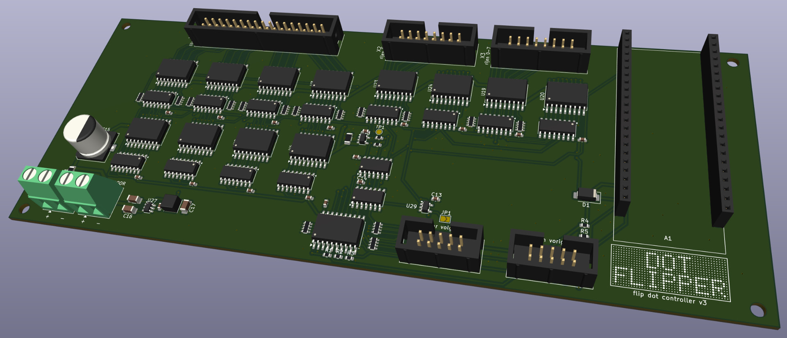

# Controller v3

> **Untested.** The schematic, placement, scripts and part choices were made with an AI assistant
> (Claude); the board was routed by hand in KiCad. The board passes DRC, but none has been built yet.
> Test the first board with a current-limited supply: these drivers switch 20 V coils, and a mistake
> can short them.

One flip dot panel (32x32, two 32x16 halves) per board, 205 x 80 mm, two layers, all logic and drivers SMD.

## How it works

- **Drivers:** six groups of eight lines. Each group has two 74HC595s on the same data, one feeding an
  XL62783 (lines to 20 V) and one feeding a ULN2803A (lines to ground). Groups 1-4 drive the 32 lines on
  X1, group 5 rows 0-7 on X3, group 6 rows 8-15 on X2. `bits.csv` lists which bit drives which wire.
- **Protection:** DIR_X1, DIR_ROW and nOE gate the output enables of the 595s through a 74HC32 and
  74HC14, so plus and minus of one line or row can never be on together, also not after a software bug.
  Change DIR only while nOE is high.
- **Chain:** boards chain over a 10-way flat cable, J2 of one board to J3 of the next. Each board
  buffers the incoming signals with a 74AHCT541 (TTL inputs, so the 3.3 V of the ESP32 is enough), and
  the chain data leaves through a 74LVC1G79 on the falling SCLK edge. Close JP1 on the last board: the
  chain data then returns over RET to the ESP32 (IO13, through R4/R5 to 3.3 V) so the firmware can read
  the chain back.
- **ESP32:** one ESP32-S3-DevKitC-1 (A1) drives all boards; on the other boards A1 stays empty.
  DATA IO11, SCLK IO12, LATCH IO10, nOE IO9, DIR_X1 IO14, DIR_ROW IO8, return IO13, coil current IO4.
- **Coil current:** all ULN2803As return to ground through a 0.1 ohm shunt (R8). An INA180A2 measures
  it; R6/R7 scale 0.45 A to 1.5 V for IO4. TP1 brings the same signal out on boards without an ESP32.
- **Power:** 20 V in on J4, J5 passes it on to the next board. 3 A fuse F1, 220 uF bulk capacitor C15.
  An AP63205 buck makes 5 V for the logic and, through D1, for the ESP32 (D1 keeps USB power on the
  ESP32 from feeding the board).

## Files

- `generate.py`: makes the schematic and brings the board up to date; placement and tracks stay.
  `--opnieuw` throws the board away and places everything again.
- `export_jlc.py`: Gerbers, drill files, BOM and CPL for JLCPCB in `jlcpcb/`. It refuses to run while
  DRC finds errors, open connections or differences with the schematic.
- `jlcpcb/`: the production files of the current board. Through-hole parts (connectors, headers,
  terminals, the ESP32) are not in the BOM; order and solder them yourself.
- `v3.kicad_dru`: design rules for JLCPCB standard 2-layer 1 oz boards.
- `bits.csv`: which bit of the chain drives which wire, for the firmware.

## Not yet verified on hardware

- Coil peak current: estimated 450-480 mA, the drivers are rated 390-400 mA recommended, 500 mA absolute.
- The ESP32 footprint: print it 1:1 and lay the module on it, clones are not always the same.
- The buck regulator layout.
- The part rotations in the CPL, checked only in the JLC preview.
